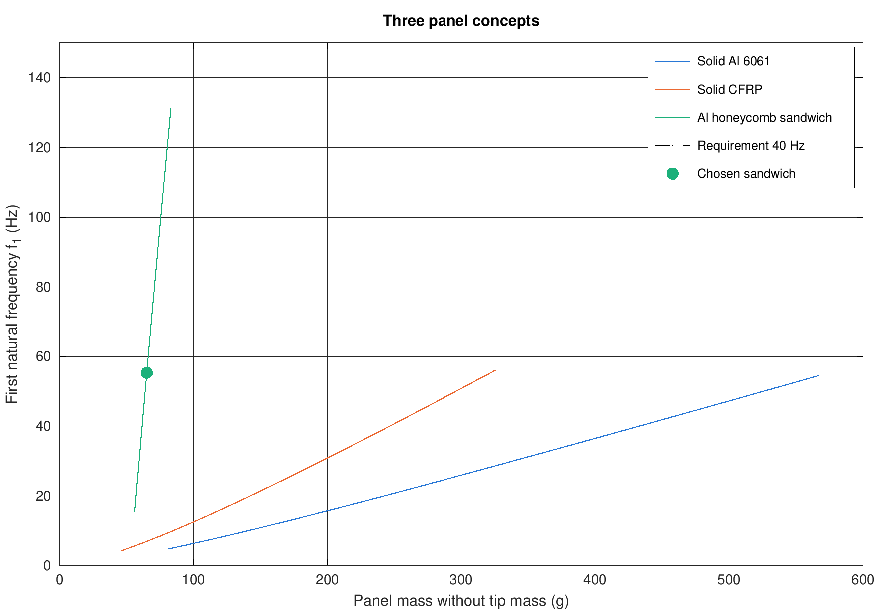

# Solar Panel Vibration Design (Falcon 9 Rideshare 40 Hz Requirement)

Sizing of a deployable solar panel for a small satellite so that its first
natural frequency is above 40 Hz, as required by the SpaceX Rideshare Payload
User's Guide (Sec. 4.1.1). The panel is modeled as a cantilever with a tip mass.

The work has three levels of analysis:

1. hand formula (Rayleigh method),
2. my own beam finite element code in MATLAB,
3. a solid model in ANSYS Mechanical (modal and harmonic analysis).

Full report: [report/main.pdf](report/main.pdf)

## Main results

| | Value |
|---|---|
| FEM code vs exact cantilever solution | error < 0.001 % with 8 elements |
| Solid Al 6061 panel, 300 x 100 mm, 50 g tip mass | needs 6 mm, f1 = 45.7 Hz, 486 g |
| Al honeycomb sandwich, 8 mm core | f1 = 55.3 Hz, 65 g (87 % lighter) |
| ANSYS solid model, 6 mm Al panel | f1 = 46.7 Hz, margin 16.7 % over 40 Hz |
| ANSYS vs beam model | +2.1 % (plate effect, b/L = 1/3) |
| Tip acceleration at resonance, 1 g input, 2 % damping | 34.9 g (ANSYS), 35.1 g (MATLAB) |
| Root bending stress, 1 g input | 32.3 MPa (ANSYS), 32.2 MPa (MATLAB) |



## How to run

Open the `matlab` folder in MATLAB and type

```
run_all
```

Figures are saved to `figures/`, tables are printed in the Command Window.
The output of my run is in `results_log.txt`.

## Files

| File | Description |
|---|---|
| `matlab/panel_params.m` | all input data (geometry, materials, requirement) |
| `matlab/beam_fem.m` | cantilever beam FEM: frequencies, mode shapes, M and K |
| `matlab/step1_validation.m` | check of the FEM code against the exact solution |
| `matlab/step2_design.m` | thickness study for solid Al and CFRP panels |
| `matlab/step2b_sandwich.m` | honeycomb sandwich panel |
| `matlab/sandwich_f1.m` | stiffness, mass and f1 of a sandwich panel |
| `matlab/step3_sine_response.m` | sine base excitation: transmissibility, root stress, margin |
| `matlab/step4_compare_ansys.m` | ANSYS mesh convergence and comparison with MATLAB |
| `figures/ansys/` | ANSYS screenshots (mesh, mode shapes, harmonic results) |
| `report/` | LaTeX source and PDF of the report |

## Tools

MATLAB, SolidWorks (geometry), ANSYS Mechanical 2026 R1 Student.

## Limitations

- The hinge is modeled as rigid, so real frequencies will be lower.
- The sine input is a unit 1 g level; real levels from the user's guide must be applied.
- The sandwich panel was analyzed only with the beam model (no core shear, no ANSYS model).
